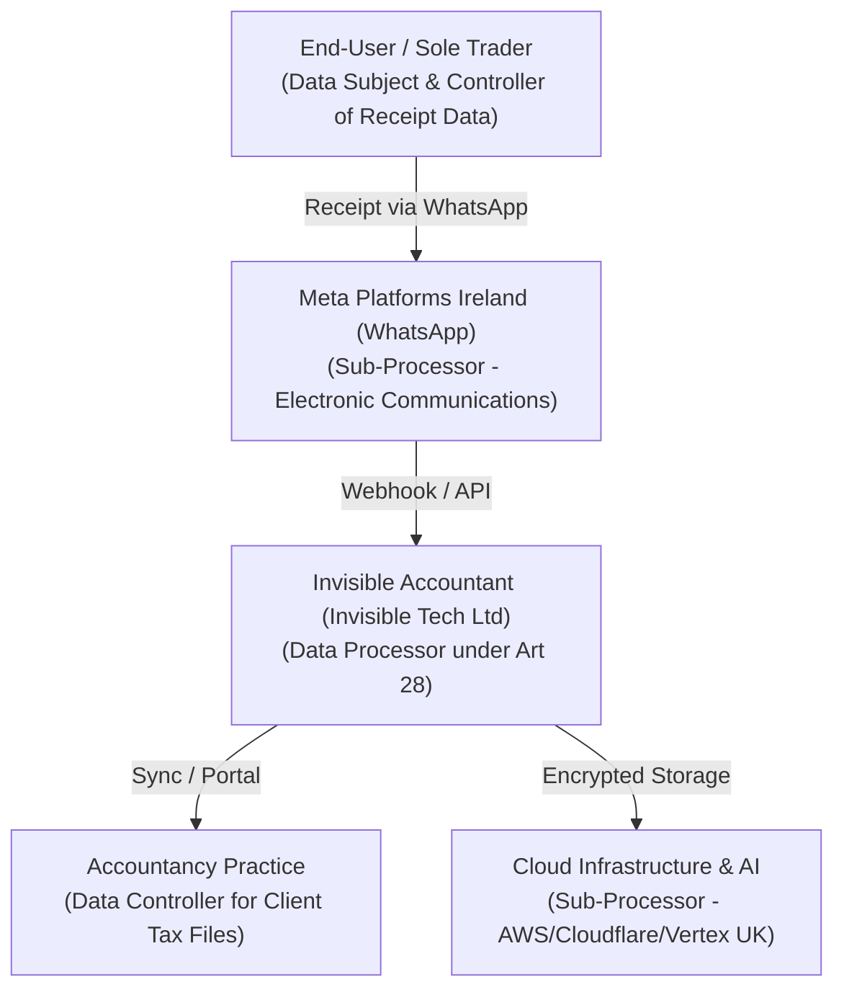
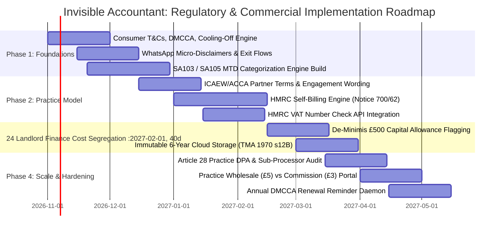

# INVISIBLE ACCOUNTANT: STATUTORY REGULATORY, ACCOUNTING & PARTNERSHIP FRAMEWORK
## Dual-Sided Pricing Model: £9.99/mo End-User & £0 Base + £3/client/mo Practice Commission (or £5 Wholesale)
**Lead Author:** UK Chartered Accountant & Regulatory Compliance Lead (ICAEW / CTA / FCA / HMRC Specialism)  
**Target Entity:** Invisible Accountant (Invisible Tech Ltd)  
**Jurisdiction:** England & Wales (UK Tax, Consumer & Financial Law)  
**Effective Date:** October 2026 / Pre-MTD ITSA Launch  

---

## EXECUTIVE SUMMARY & UNVARNISHED COMMERCIAL TRUTH

The approved pricing architecture (£9.99/mo direct end-user subscription; £0 base fee + £3.00/client/mo practice commission, or £5.00/client wholesale) is commercially compelling, but introduces severe statutory liabilities across four UK regulatory regimes:
1. **ICAEW / ACCA Professional Conduct:** The £3.00/client monthly commission constitutes a "referral fee/commission" under **ICAEW Code of Ethics Section 330** and **ACCA Rulebook Section 330**. Under English fiduciary and agency law, any undisclosed or improperly agreed commission is an unlawful secret profit. Firms must disclose this fee in writing *before* onboarding and secure explicit client consent in their Engagement Terms.
2. **VAT & Billing Mechanics:** The £3.00 referral fee is a standard-rated (20%) supply of intermediary marketing services by VAT-registered practices. Without an automated HMRC-compliant **Self-Billing Agreement (VAT Notice 700/62)**, the platform risks massive VAT leakage, non-compliance, and billing friction across hundreds of accounting firms.
3. **Consumer Protection & FCA Perimeter:** Direct end-user billing (£9.99/mo or £99/yr) engages the **Consumer Contracts Regulations 2013 (CCRs)** and the **Digital Markets, Competition and Consumers Act 2024 (DMCCA)**. The platform must provide a statutory 14-day cancellation mechanism (usable directly via WhatsApp and web), clear pre-contract information, and transparent recurring subscription controls without dark patterns. Conversely, pure software commissions sit safely outside the FCA credit-broking and insurance distribution perimeters under the **Financial Services and Markets Act 2000 (Regulated Activities Order 2001)**.
4. **HMRC MTD ITSA Compliance (TMA 1970 s12B & SI 2021/1076):** Digital records require strict preservation of tax point, net, VAT, gross, and unbroken digital links. Expense mapping must rigorously segregate **Sole Trader trade expenses (SA103)** from **UK Property Income (SA105)**. In particular, residential landlord mortgage interest must never be expensed against rental profit, but segregated under **s272A ITTOIA 2005 (Section 24)** for basic-rate tax reduction.
5. **UK GDPR & DPA 2018:** The Accountancy Practice acts as **Data Controller** for client books, while Invisible Accountant operates as a **Data Processor** under **Article 28 UK GDPR**. A statutory Data Processing Agreement (DPA) with strict clauses regarding WhatsApp/Meta sub-processing and 6-year HMRC statutory retention is non-negotiable.

---

## 1. ICAEW CODE OF ETHICS SECTION 330 & ACCA RULEBOOK (FEES & COMMISSIONS)

### 1.1 Statutory & Ethical Framework
Under the **ICAEW Code of Ethics Section 330 (Fees and Other Types of Remuneration)** and **ACCA Code of Ethics and Conduct Section 330**:
- **The Self-Interest Threat:** Accepting a recurring commission (£3.00 per client per month) creates an immediate self-interest threat to the fundamental principles of **Objectivity** (Section 120) and **Integrity** (Section 111). A client or regulator could allege that the accountant recommended Invisible Accountant over alternatives (e.g. FreeAgent, Dext, Xero, AutoEntry) purely for financial gain rather than the client’s best interest.
- **Mandatory Professional Safeguards:**
  1. **Advance Written Disclosure:** Under ICAEW R330.3 and ACCA R330.3, the professional accountant **shall** inform the client in writing of any referral fee, commission, or discount that will be received from a third party in connection with services provided to that client.
  2. **Informed Client Consent:** The accountant must obtain the client’s informed written consent to retain the commission. If the client refuses consent, the accountant must refund the commission to the client or offset it against their professional fees.
  3. **Periodic Accounting:** The accountant must be prepared to disclose the aggregate amounts received to the client upon request.

### 1.2 Common Law & The Law of Agency (The Secret Commission Trap)
Under English common law (*Boston Deep Sea Fishing and Ice Co v Ansell [1888]*; *Mahesan v Malaysia Government Officers' Co-operative Housing Society [1979]*):
- An accountant acts in a fiduciary capacity as an agent for their client.
- An agent who accepts a financial incentive or commission from a third-party supplier without the principal's full knowledge and consent commits a civil wrong (receipt of a secret commission).
- Under the **Bribery Act 2010 (s1 & s2)**, commercial bribery risks arise if payments are made to induce an agent to act improperly in breach of their duty of good faith or impartiality.
- **Conclusion:** Full, upfront, written disclosure is not merely an ICAEW ethical guideline; it is a primary legal defense against secret commission litigation.

### 1.3 Standard Engagement Letter Disclosure Clause (Template for Practices)
To protect partner practices, Invisible Accountant must provide practices with an approved ICAEW/ACCA compliant clause for insertion into their **Terms of Business / Schedule of Services (Engagement Letter)**:

```text
CLAUSE [X]: COMMISSIONS, SOFTWARE REFERRAL FEES AND THIRD-PARTY BENEFITS
X.1 In accordance with the ICAEW Code of Ethics (Section 330) / ACCA Code of Ethics and Conduct, 
    we hereby notify you that our practice has entered into a commercial partnership with 
    Invisible Accountant (Invisible Tech Ltd).
X.2 When you subscribe to Invisible Accountant for digital receipt capture and Making Tax Digital (MTD) 
    record-keeping, we receive a recurring software commission of £3.00 (plus VAT, if applicable) per active 
    client per month from Invisible Tech Ltd.
X.3 This fee compensates our firm for the ongoing administration, technical configuration, API monitoring, 
    and quarterly digital link verification of your digital bookkeeping records.
X.4 By signing this engagement letter, you expressly consent to our firm receiving and retaining this 
    commission. If you do not consent to our retention of this fee, please notify us in writing within 14 days, 
    and we will credit the net commission received against our quarterly professional fee invoice.
```

### 1.4 VAT Treatment of the £3.00/client/month Referral Payment
- **Statutory Basis:** **Value Added Tax Act 1994 (VATA 1994) s4 & s5**.
- **Nature of Supply:** The referral payment is consideration for a taxable supply of intermediary marketing and client management services provided by the Accountancy Practice to Invisible Tech Ltd.
- **VAT Rate:** Standard-rated at **20% UK VAT**. It does NOT qualify for financial intermediary exemption (Item 1, Group 5, Schedule 9 VATA 1994) because the underlying supply is software, not an exempt financial service.
- **Commercial Gross vs Net Pricing Definition:**
  - If a practice is VAT-registered: The commercial contract must define whether £3.00 is *inclusive* or *exclusive* of VAT.
  - *Statutory Rule:* Under English contract law, B2B pricing is presumed exclusive of VAT unless stated otherwise. If the platform states "£3.00/client", a VAT-registered firm will demand £3.00 + 20% VAT = **£3.60 gross**, eroding platform gross margins.
  - *Platform Policy:* The agreement must specify:
    > "Commission is paid at £2.50 plus UK VAT (£3.00 gross) for VAT-registered practices, or £3.00 net for unregistered practices." Alternatively: "Commission is £3.00 inclusive of any applicable VAT."
- **Mandatory Self-Billing Agreement under HMRC VAT Notice 700/62:**
  - If 500 accountancy firms each invoice Invisible Tech Ltd monthly for £30 to £3,000, managing incoming supplier VAT invoices creates catastrophic administrative failure.
  - **Solution:** Invisible Accountant must deploy an automated **Self-Billing Engine**.
  - **Statutory Requirements under VAT Notice 700/62 (s3 & s4):**
    1. A formal written Self-Billing Agreement signed by both parties covering an initial 12-month period.
    2. Practice agrees that Invisible Tech Ltd will issue self-billed invoices on its behalf.
    3. Practice agrees NOT to issue VAT sales invoices for the commissions.
    4. Practice agrees to notify Invisible Tech Ltd immediately if its VAT registration number changes, is cancelled, or if the business is transferred as a going concern (TOGC).
    5. Each generated self-billed document must bear the statutory wording: **"SELF-BILLED INVOICE"**, the practice's verified VAT number, Invisible Tech Ltd's VAT number, tax point, net commission, VAT rate (20%), and VAT amount.
    6. Invisible Tech Ltd must verify every practice VAT number via HMRC’s Check a UK VAT Number API (`api.service.hmrc.gov.uk/organisations/vat/check-vat-number`).

---

## 2. CONSUMER PROTECTION & FCA REGULATORY PERIMETER

### 2.1 Consumer Contracts Regulations 2013 (CCRs 2013) & Sole Trader / Landlord Status
- **Statutory Definition of Consumer:** Under **CCRs 2013 reg 4** and **Consumer Rights Act 2015 (CRA 2015) s2(3)**:
  - A "consumer" is an individual acting for purposes that are wholly or mainly outside that individual's trade, business, craft, or profession.
  - A sole trader purchasing business record-keeping software is legally in business (B2B).
  - **The Landlord & Side-Hustle Hazard:** Individual residential landlords (especially single-property / accidental landlords) and gig-economy workers often claim consumer status. UK Trading Standards and County Courts adopt an expansive view of consumer protection where checkout flows are open to the general public and processed via consumer payment rails (Apple Pay, Stripe Checkout).
- **The 14-Day Statutory Cooling-Off Period (CCRs 2013 Reg 29, 36 & 37):**
  - For digital services and rolling subscriptions sold remotely:
  - **Digital Service Commencing Immediately:** Under Reg 36(1), the consumer has a statutory right to cancel within 14 days of contract conclusion.
  - If the consumer requests service commencement immediately during the cancellation period:
    - The platform must obtain **express request and acknowledgement** at checkout:
      > *"By completing signup, you expressly request that Invisible Accountant begins providing digital receipt extraction and tax estimation services immediately. You retain the right to cancel within 14 days, in which case you will receive a refund proportionate to the service provided up to cancellation."*
  - **Cancellation Mechanisms (No Dark Patterns):**
    - The user must be able to cancel without friction via both:
      1. **WhatsApp Command:** Sending `"CANCEL"` or `"STOP SUBSCRIPTION"` initiates an automated immediate cancellation flow with a single confirmation button: `[Confirm Cancellation]`.
      2. **Web Portal:** A 1-click `Cancel Subscription` button in the user settings.

### 2.2 Digital Markets, Competition and Consumers Act 2024 (DMCCA 2024) Compliance
The DMCCA 2024 introduces strict statutory requirements for consumer subscription contracts:
1. **Pre-Contract Information:** Explicit disclosure of the recurring fee (£9.99/mo or £99/yr), billing frequency, minimum commitment (none for monthly, 1 year for annual), and cancellation steps.
2. **Renewal Reminder Notices:**
   - For the £99/year subscription, the platform **must** send statutory reminder notices:
     - First notice: 28 days prior to renewal.
     - Second notice: 7 days prior to renewal.
     - Must state the upcoming charge (£99.00), renewal date, and a direct link to cancel.
3. **Exit Parity:** Terminating the subscription must be just as easy as entering it (one-step cancellation; no mandatory phone calls, questionnaires, or retention roadblocks).
4. **CRA 2015 Unfair Terms:** Unilateral price increase clauses without 30 days' advance notice and penalty-free cancellation rights are void under CRA 2015 Schedule 2.

### 2.3 FCA Regulatory Perimeter Analysis (FSMA 2000 & RAO 2001)
- **Credit Broking Perimeter (Article 36A RAO):**
  - Invisible Accountant does not introduce clients to credit providers, offer Buy-Now-Pay-Later (BNPL), or provide credit facilities. Monthly subscription fees paid in advance are excluded from the Consumer Credit Act 1974.
- **Insurance Distribution Perimeter (Article 21 & 53 RAO):**
  - The platform does not sell, introduce, or administer tax fee protection insurance.
- **Payment Services & Open Banking (PSRs 2017):**
  - Invisible Accountant does not handle client money or execute payment transactions.
  - If bank feeds are connected, the platform operates purely via regulated third-party Account Information Service Providers (AISP) (e.g. TrueLayer, Plaid, Yapily) under the **Technical Service Provider (TSP)** exemption (Regulation 3 PSRs 2017).
- **Software Referral Commission Status:**
  - Paying an accountancy firm £3.00/client/month for introducing bookkeeping software is an **unregulated commercial software affiliate arrangement**. It does **not** constitute a regulated financial promotion or regulated activity under **FSMA 2000 Section 19**.
- **FCA Consumer Duty (PRIN 2A) & Accountancy Practices:**
  - While Invisible Tech Ltd is unregulated, accountancy practices holding **Designated Professional Body (DPB)** licensing from ICAEW/ACCA or dual FCA permissions are subject to the Consumer Duty. By providing transparent, fair-value, and reliable software, the platform ensures partner practices do not breach PRIN 2A outcome rules.

---

## 3. HMRC MTD ITSA COMPLIANCE (TMA 1970 s12B & VAT NOTICE 700/22)

### 3.1 Digital Record-Keeping Requirements
Under **Taxes Management Act 1970 (TMA 1970) s12B**, **The Income Tax (Digital Requirements) Regulations 2021 (SI 2021/1076)**, and HMRC MTD ITSA specifications:
- **Mandatory Digital Record Elements for Every Transaction:**
  1. **Tax Point / Transaction Date:** Date of invoice, receipt, or payment.
  2. **Monetary Value:** Gross amount, Net amount, and VAT breakdown (if VAT-registered).
  3. **HMRC Expense / Income Category:** Aligned to the statutory return schedules.
- **The Statutory Digital Link Mandate:**
  - Data transfer between applications (WhatsApp extraction -> Core DB -> Practice Portal -> Xero/QBO API -> HMRC API) must be executed exclusively via digital links.
  - **Strict Prohibition:** Manual retyping, transcription, copy-pasting, or manual editing between systems violates the digital link requirement.
- **Document Image Retention Period:**
  - Under TMA 1970 s12B(2), business records must be preserved for **5 years after the 31 January following the end of the tax year** (e.g. records for the 2026/27 tax year ending 5 April 2027 must be preserved until **31 January 2033**).
  - Invisible Accountant must store the original receipt image/PDF, extraction JSON payload, and SHA-256 cryptographic hash in immutable cloud object storage (e.g. AWS S3 Glacier / Cloudflare R2) for a minimum of **6 full calendar years**.

---

### 3.2 Dual-Schedule Category Mapping: SA103 (Sole Trader) vs SA105 (UK Property)
Under UK tax law, **trading profits (Part 2 ITTOIA 2005)** and **property income (Part 3 ITTOIA 2005)** cannot be merged. The platform’s AI categorization engine must maintain two distinct, uncompromised mapping trees:

#### Schedule A: SA103 Self-Employment (Sole Traders)
| SA103 Box | HMRC Return Description | WhatsApp Engine Mapping Rules & Restrictions |
|---|---|---|
| **Box 11** | Cost of goods bought for resale / materials | Raw materials, wholesale goods, inventory. |
| **Box 12** | Construction industry subcontractor costs | Subcontractors under CIS (requires UTR and CIS deduction check). |
| **Box 13** | Wages, salaries and other staff costs | Gross wages, employer NICs, employer pension contributions. |
| **Box 14** | Car, van and travel expenses | Fuel, public transit, hotels, or simplified mileage (45p/mile first 10k, 25p thereafter under s94D ITTOIA 2005). Commuting disallowed. |
| **Box 15** | Rent, rates, power and insurance | Business premises rent, business rates, commercial utility bills. |
| **Box 16** | Repairs and maintenance | Equipment and property repairs. Capital improvements disallowed. |
| **Box 17** | Phone, fax, stationery and office costs | Business phone, postage, office supplies, software subscriptions. |
| **Box 18** | Advertising and marketing costs | Online ads, PR, website hosting. **Client entertainment strictly disallowed** under s45 ITTOIA 2005. |
| **Box 19** | Interest on bank and other loans | Business loan interest, overdraft interest. |
| **Box 20** | Bank and financial charges | Bank account fees, merchant payment processing fees (Stripe, SumUp). |
| **Box 21** | Accountancy, legal and professional fees | Legal costs for trading contracts, accountancy fees. Capital legal costs disallowed. |
| **Box 22** | Other allowable business expenses | Sundry allowable trading expenses. |
| **Box 23-26** | Capital Allowances (AIA / WDA) | Assets over de-minimis threshold (£500) must NOT be expensed in Box 11-22. Flagged for Capital Allowances under CAA 2001. |

#### Schedule B: SA105 UK Property Income (Residential & Commercial Landlords)
| SA105 Box | HMRC Return Description | WhatsApp Engine Mapping Rules & Statutory Traps |
|---|---|---|
| **Box 20** | Rent and other property income | Gross rental income, insurance payouts, service charges received. |
| **Box 24** | Rent, rates, insurance, ground rent | Ground rents, landlord building insurance, landlord council tax. |
| **Box 25** | Property repairs and maintenance | **Strict repair vs improvement rule (BIM46900):** Only like-for-like repairs (e.g. repainting, fixing broken boiler) allowable. Modernization/extensions are capital improvements and must be disallowed from revenue. |
| **Box 26** | Legal, management and other professional fees | Letting agent fees, tenancy agreement legal fees, eviction legal costs. |
| **Box 27** | Costs of services provided (including wages) | Communal cleaning, gardening, concierge services. |
| **Box 28** | Other allowable property expenses | Gas safety certificates, EPC inspections, smoke alarm checks. |
| **Box 44** | **Residential Finance Costs (s272A ITTOIA 2005)** | **CRITICAL STATUTORY TRAP (Section 24):** Mortgage interest, loan interest, and financing fees for residential lettings **MUST NEVER be deducted in Box 28**. They must be routed to Box 44 to calculate the **20% basic-rate tax relief**. Deducting mortgage interest directly from rental profit is an illegal error subject to Schedule 24 FA 2007 penalties! |

---

### 3.3 Statutory Disclaimers on "Tax Estimation" in WhatsApp
Under common law (*Hedley Byrne & Co Ltd v Heller & Partners Ltd [1964] AC 465*) and statutory standards:
- Real-time tax estimations in WhatsApp risk being construed as **negligent tax advice** if a user under-provisions for tax due to missing data (payments on account, Student Loans, High Income Child Benefit Charge, pension relief).
- **Mandatory WhatsApp Micro-Disclaimer (appended to every calculation card):**
  > *"Estimated Tax & NIC: £X,XXX. ⚠️ Indicative calculation based solely on receipts logged in this chat. Excludes Personal Allowance tapering, Student Loans, payments on account, and year-end accountant adjustments. This is not formal tax advice or an HMRC assessment."*
- **Terms of Service Statutory Exclusion:**
  > "The Service generates automated estimations based exclusively on optical character recognition and user input. The Service is not a qualified tax advisor, does not provide regulated tax, legal, or accounting advice, and does not submit tax returns directly to HMRC without practice or user authorization. The User remains solely liable for their statutory obligations under the Taxes Management Act 1970."

---

## 4. UK GDPR & DATA PROTECTION ACT 2018 (DPA 2018)

### 4.1 Controller vs Processor Roles & Architecture


- **Practice Portal Model:**
  - **Accountancy Practice:** **Data Controller** (determines purposes and means of client tax preparation and compliance).
  - **Invisible Accountant:** **Data Processor** acting solely under the documented instructions of the Practice under **Article 28 UK GDPR**.
- **Direct End-User Model:**
  - Invisible Accountant acts as **Data Controller** for customer account, billing, and subscription identity data.
  - Invisible Accountant acts as **Data Processor** for the business documents and personal data contained on third-party receipts uploaded by the user.

### 4.2 Data Processing Agreement (DPA) Mandatory Clauses (Article 28 UK GDPR)
The B2B Practice Portal agreement must embed a statutory DPA containing:
1. **Subject Matter & Duration:** Digital receipt capture, OCR parsing, MTD transaction categorization, and practice synchronization for the duration of the engagement.
2. **Documented Instructions:** Invisible Tech Ltd shall process personal data only on documented instructions from the Practice (including with respect to data transfers).
3. **Personnel Confidentiality:** Mandatory statutory confidentiality undertakings for all employees, contractors, and AI pipeline administrators.
4. **Security of Processing (Article 32):**
   - End-to-end encryption in transit (TLS 1.3).
   - AES-256-GCM encryption at rest for all database tables and object storage.
   - Strict database tenant isolation preventing cross-practice data access.
5. **Sub-Processor Management (Article 28(2) & 28(4)):**
   - General written authorization granted for Meta Platforms Ireland (WhatsApp Business API), cloud hosting (AWS London / GCP europe-west2), and LLM inference engines.
   - Platform must provide 30 days’ notice before onboarding any new sub-processor, giving the practice the right to object.
   - Specific contractual guarantee: **Zero Customer Data Retention for AI Model Training** (API prompts and receipt data are not used to train foundation models).
6. **Data Subject Rights Assistance (Chapter III):** Automated features enabling practices to respond to Data Subject Access Requests (DSARs), rectification requests, and erasure requests within statutory timeframes.
7. **Personal Data Breach Notification (Article 33):** Invisible Tech Ltd must notify partner practices **without undue delay and no later than 48 hours** upon becoming aware of any confirmed personal data breach affecting client data.
8. **Data Return & Deletion:** Upon termination of the practice agreement, all client personal data must be permanently deleted or exported to the practice within 90 days, except where retention is required by UK statute (**TMA 1970 s12B**).

---

## 5. FOUR-PHASE IMPLEMENTATION ROADMAP



### Phase 1: Regulatory Foundations & Direct Consumer Compliance (Months 0–2)
- **Legal Architecture:** Publish updated Terms of Service, Privacy Notice, and CCRs 2013-compliant pre-contract disclosures.
- **WhatsApp UI/UX Integration:**
  - Build automated 1-step cancellation via WhatsApp (`"CANCEL"` command).
  - Implement dynamic micro-disclaimers appended to every tax estimation output.
- **Categorization Engine Core:**
  - Fork rule engine to explicitly differentiate SA103 (Sole Trader) from SA105 (Property).
  - Enforce hard disallowance on client entertainment (s45 ITTOIA 2005) and residential mortgage interest deductions (s272A ITTOIA 2005).

### Phase 2: Practice Partnership Architecture & Self-Billing Engine (Months 2–4)
- **Practice Onboarding Pack:**
  - Issue ICAEW Code of Ethics Section 330 & ACCA compliant engagement letter template clauses.
  - Implement digital signature for Partner Agreement and Article 28 DPA.
- **Automated Self-Billing Engine:**
  - Build the VAT Notice 700/62 self-billing generator.
  - Integrate HMRC Check a UK VAT Number API for automated practice VAT status validation.
  - Establish monthly commission batch engine generating PDF self-billed invoices and automated BACS/Stripe transfers.

### Phase 3: HMRC MTD ITSA Engine, Digital Links & Capital Assets (Months 4–6)
- **Digital Link Certification:**
  - Audit all end-to-end data transfers (WhatsApp -> Core DB -> Xero/QBO) to ensure zero manual copy-paste intervention.
  - Create exportable digital audit log proving chain of custody and unbroken digital links for HMRC inspection.
- **Asset Capitalization & Landlord Engine:**
  - Implement £500 de-minimis threshold detection routing hardware/machinery to Capital Allowances.
  - Deploy Section 24 Landlord Finance Cost isolation, routing mortgage interest strictly to SA105 Box 44 for basic-rate tax relief.
- **Immutable Long-Term Storage:**
  - Configure WORM (Write Once, Read Many) cloud object retention guaranteeing 6-year preservation under TMA 1970 s12B.

### Phase 4: Consumer Duty, DMCCA Hardening & Practice Scale (Months 6+)
- **DMCCA Subscription Daemon:**
  - Deploy automated scheduled reminders (28 days and 7 days) for annual £99 subscribers.
  - Implement audit logs verifying exit parity and zero subscription trap friction.
- **Dual Commercial Portal:**
  - Deploy portal toggling between:
    - **Option A (Referral):** Client billed £9.99/mo direct; practice receives £3.00/client/mo self-billed commission.
    - **Option B (Wholesale):** Practice billed £5.00/client/mo wholesale; practice white-labels or bundles service into their own fixed monthly accounting packages.
- **Independent Compliance Audit:**
  - Engage external UK compliance counsel and ICAEW practitioner to perform full pre-launch review prior to April 2026/2027 MTD ITSA enforcement deadlines.

---

## 6. STATUTORY RISK & PENALTY MATRIX

| Area | Statutory Authority | Compliance Failure Mode | Legal & Financial Consequence | Mitigation Enforced in Architecture |
|---|---|---|---|---|
| **Commissions** | ICAEW s330 / ACCA s330 / Common Law | Practice fails to disclose £3/mo commission to client | Investigation by ICAEW/ACCA Professional Conduct Committee (PCC); civil action for recovery of secret profit; breach of fiduciary duty. | Mandatory client engagement letter schedule provided to practice during onboarding; recorded consent flag. |
| **VAT on Commissions** | VATA 1994 s4 / VAT Notice 700/62 | Platform pays £3 without VAT accounting or invalid self-billing | Assessment for undeclared output VAT + default surcharges under s59/s59A VATA 1994. | Automated Self-Billing Engine verifying practice VAT numbers via HMRC API; clear gross/net contract definition. |
| **Cooling-Off & Subscriptions** | CCRs 2013 / DMCCA 2024 | Hidden renewals, no WhatsApp cancellation | Contracts unenforceable; Trading Standards fines up to 10% of global turnover under DMCCA; consumer chargebacks. | 1-step WhatsApp and web cancellation; pre-contract statutory consent; automated annual renewal notices. |
| **Tax Estimation Liability** | Tort (*Hedley Byrne*) / FA 2016 s162 | User relies on WhatsApp estimate to their financial detriment | Professional negligence claims; advertising complaints to ASA; regulatory exposure. | Prominent, automated in-chat micro-disclaimer clarifying calculations are purely indicative estimates. |
| **Landlord MTD Errors** | ITTOIA 2005 s272A / FA 2007 Sch 24 | Deducting mortgage interest as revenue expense in SA105 Box 28 | HMRC Careless Error Penalties (up to 30% of understated tax under Sch 24 FA 2007) levied on taxpayer/practice. | Automated Section 24 rule engine isolating residential mortgage interest strictly to Box 44 basic-rate relief. |
| **Digital Links** | SI 2021/1076 / TMA 1970 s12B | Manual retyping or broken CSV/API links | Software de-listed from HMRC compatible software register; MTD compliance penalties on client. | Fully automated API pipeline with cryptographically signed digital audit logs. |
| **UK GDPR** | UK GDPR Art 28 / DPA 2018 | Operating practice portal without executed DPA | ICO fines up to £17.5m or 4% of turnover; breach of contract claims by accounting firms. | Click-to-accept statutory Article 28 DPA embedded in Practice Portal signup with strict sub-processor clauses. |

---
*Signed and sealed for implementation by UK Chartered Accountant & Regulatory Compliance Lead.*
